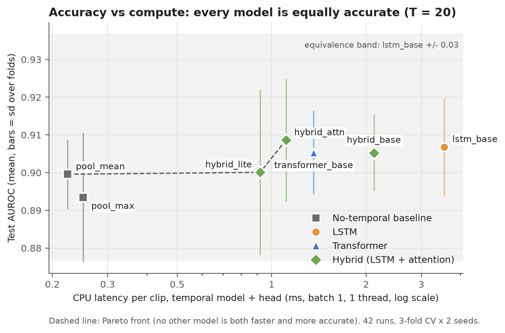

# Compute vs. Accuracy Trade-off in LSTMs and Transformers for Medical Video Classification

A controlled study of the trade-off between classification accuracy and CPU compute cost when an
LSTM temporal model is replaced by a Transformer encoder, applied to short clinical screening
videos labelled **Normal** or **Abnormal**.

**Status (4 Nov 2026): main experiment complete.** 42 training runs (7 models x 3 folds x 2 seeds
at T = 20) and the CPU benchmark are done; results, figures and a written report are in the repo.
See [Results and conclusions](#results-and-conclusions).

---

## Overview

Medical video classifiers usually combine a per-frame convolutional network with a temporal model
that aggregates information across frames. The two dominant temporal models are:

- **LSTMs**, which process frames sequentially and are compact.
- **Transformers**, which relate all frames to each other through self-attention. They are
  generally more accurate on large datasets, but are assumed to be more expensive.

Clinical screening deployments face three constraints that make that comparison unclear:

- datasets are small and imbalanced
- clips are short
- inference often runs on ordinary CPUs

This project measures both sides of the trade-off under controlled conditions:

- **Accuracy:** AUROC, sensitivity at 90% specificity, macro-F1, balanced accuracy, sensitivity
  and specificity, under stratified cross-validation. Missing an Abnormal clip is treated as the
  costlier error.
- **Compute:** parameters, FLOPs, inference latency, throughput, peak memory, training time and
  model size, measured on a CPU-only machine.

The study is built around a null hypothesis taken from prior work. On short clips represented by
frozen CNN features, a Transformer temporal head is **not** more accurate than an LSTM head. The
compute side is measured rather than assumed.

Full motivation and scope:
[summary](docs/01_summary.md), [abstract](docs/02_abstract.md), [scope](docs/03_scope.md) and
[why it matters](docs/04_why_it_matters.md).

## Research questions

| ID | Question |
|---|---|
| RQ1 | With identical frozen frame features, is a Transformer temporal head more accurate than an LSTM head? |
| RQ2 | What does each family cost on CPU (parameters, FLOPs, latency, memory, training time)? Is the temporal head even a significant share of end-to-end cost? |
| RQ3 | How do accuracy and cost scale with clip length T ∈ {10, 20, 40}? (not run: the study was fixed at T = 20) |
| RQ4 | Which models are Pareto-optimal in accuracy vs. latency, and which should be deployed on CPU? |

## Results and conclusions

Main experiment: 7 models, T = 20 frames, stratified 3-fold cross-validation x 2 seeds (6 paired
test folds per model, 77 Abnormal clips each), CPU timings on an Intel i5-12450H.

| Model | AUROC | Sens. at 90% spec. | Latency (batch 1, 1 thread) | MACs per clip | Equivalent to `lstm_base` (+/- 0.03) |
|---|---:|---:|---:|---:|---|
| `hybrid_attn` | **0.909** | **0.760** | 1.11 ms | 8.6 M | Yes |
| `lstm_base` | 0.907 | 0.749 | 3.54 ms | 35.4 M | reference |
| `transformer_base` | 0.905 | 0.699 | 1.36 ms | 28.0 M | Yes |
| `hybrid_base` | 0.905 | 0.701 | 2.12 ms | 17.2 M | not shown (wide CI) |
| `hybrid_lite` | 0.900 | 0.684 | 0.92 ms | 3.0 M | not shown (wide CI) |
| `pool_mean` | 0.900 | 0.665 | 0.22 ms | 0.08 M | Yes |
| `pool_max` | 0.893 | 0.639 | 0.25 ms | 0.08 M | not shown (wide CI) |



**Conclusions**

1. **The LSTM and the Transformer are equally accurate** (AUROC 0.907 vs 0.905; difference -0.001,
   90% CI inside the pre-registered +/- 0.03 margin). H0-acc is supported.
2. **The Transformer is cheaper:** 2.6 times faster per clip on one CPU thread (1.36 vs 3.54 ms),
   with 21% fewer parameters and MACs. H0-cpu is supported. At batch 32 on 8 threads they tie.
3. **There is no compute-versus-accuracy trade-off here.** Accuracy is flat while compute varies
   16-fold in latency and about 430-fold in arithmetic. Even `pool_mean`, which ignores frame
   order, is equivalent in AUROC.
4. **The temporal model is under 1% of end-to-end time.** Decoding (about 145 ms) and MobileNetV2
   on 20 frames (about 312 ms) dominate; fewer frames or a lighter backbone would save far more.
5. **Recommendation:** `hybrid_attn` as the best all-round model (best accuracy and screening
   sensitivity, 3.2 times faster than the LSTM); `pool_mean` as the cheapest acceptable one.
6. **For screening,** a cut-off chosen on validation for 95% sensitivity catches 87–92% of
   Abnormal test clips (6 to 10 of 77 missed per fold) with NPV about 0.95, at the cost of about
   one false alarm per true Abnormal. Fewer misses most likely need better frame features.

Details: [results and conclusions](docs/05_results.md),
[full tables and per-run numbers](results/results_3fold_T20.md),
[figures](graphs/README.md), and the
[written report (PDF)](docs/report/Compute_vs_Accuracy_LSTM_Transformer_Report.pdf).

## Dataset

The dataset is pediatric ear (otoscopy) screening video from an existing curated pipeline.

| Property | Value |
|---|---|
| Videos | 874 |
| Labels | 643 Normal / 231 Abnormal (26.4% Abnormal; majority-class accuracy 73.6%) |
| Resolution | 480 × 640 (portrait), all videos |
| Duration | median 13.1 s (range 0.9 to 71.1 s), 18 to 2078 frames (median 374), median 29.0 fps |
| Ages | 3 to 18 (median 11) |
| Metadata | `labels.json`: `{id, interpretation, age}` |

Each test fold holds 291 to 292 clips, 77 of them Abnormal (3-fold cross-validation), so
single-fold AUROC is still noisy. Repeated cross-validation and paired tests matter more than usual.

Abnormal is treated as the positive class throughout. The data is private clinical material and
**is not included in this repository**. Details: [data pipeline design](docs/data_pipeline.md).

## Method

### Pipeline

```
video (.mp4)
  │  uniform sampling of T frames, sequential decode, BGR → RGB, resize to 224 × 224
  ▼
MobileNetV2 (ImageNet weights, frozen, global average pooling)     run once, features cached
  ▼
frame embeddings (T, 1280)
  ▼
temporal block (the only component that varies between models)
  │  LSTM:         LSTM(256) → LSTM(128)
  │  Transformer:  Dense(1280 → d) + learned positional embedding
  │                → N × [pre-LN multi-head attention + feed-forward] → LayerNorm → mean pooling
  │  Hybrid:       LSTM(128) → one Transformer block → mean / attention + max pooling
  │  Baseline:     no temporal block; mean or max over frames
  ▼
classifier head (identical for all models): Dense(64, ReLU) → Dropout(0.5) → Dense(1, sigmoid)
```

### Controls

The comparison is only valid if every model sees the same inputs and the same training budget.
The following are held fixed across all models:

- **Features.** MobileNetV2 runs once at T = 40, and the features are cached. T = 20 and T = 10
  are uniform subsamples of the same frames.
- **Folds.** Stratified 3-fold cross-validation with a stratified 15% inner validation split for
  early stopping, repeated with two seeds (0 and 1). Folds are saved to disk and shared by all
  models.
- **Head and training.** Identical classifier head, binary cross-entropy with balanced class
  weights, batch size, epoch budget, and early stopping on the exact validation AUROC.
- **Preprocessing.** `mobilenet_v2.preprocess_input` scaling and RGB channel order, matching the
  ImageNet weights.

### Models

Every model below is implemented and builds correctly. Parameter counts are verified with
TensorFlow 2.17 / Keras 3.6. The main experiment trained the seven models from `lstm_base` down;
`lstm_small`, `bilstm_base`, `transformer_small` and `transformer_deep` are defined but not trained.

| Preset | Temporal block | Parameters (T = 20) | MACs per clip (T = 20) |
|---|---|---:|---:|
| `lstm_small` | LSTM(128) | 729,729 | 14.4 M |
| `lstm_base` | LSTM(256) → LSTM(128) | 1,779,329 | 35.4 M |
| `bilstm_base` | BiLSTM(128) → BiLSTM(64) | 1,615,489 | 32.1 M |
| `transformer_small` | d = 128, 4 heads, FFN 256, 2 layers | 440,065 | 8.7 M |
| `transformer_base` | d = 256, 4 heads, FFN 512, 2 layers | 1,404,289 | 28.0 M |
| `transformer_deep` | d = 256, 8 heads, FFN 512, 4 layers | 2,458,497 | 49.3 M |
| `hybrid_base` | LSTM(128) → 1 Transformer block → mean pool | 862,465 | 17.2 M |
| `hybrid_attn` | Dense(128) → LSTM(128) → 1 block → attention + max pool | 444,930 | 8.6 M |
| `hybrid_lite` | Dense(64) → LSTM(64) → 1 block → attention + max pool | 156,994 | 3.0 M |
| `pool_mean` (baseline) | none: mean of frame features | 82,049 | 0.08 M |
| `pool_max` (baseline) | none: per-feature max over frames | 82,049 | 0.08 M |

- `transformer_base` is the parameter-matched counterpart of `lstm_base`; they form the primary
  comparison.
- The two pooling baselines ignore frame order. They show whether temporal modelling helps at
  all; if a baseline matches the temporal models, the cheapest model is the better choice.
- `hybrid_attn` and `hybrid_lite` shrink each frame before the LSTM (so the LSTM is cheap) and use
  attention plus max pooling, so evidence from a few informative frames is not averaged away.
- For reference, the frozen MobileNetV2 backbone costs about 300 M MACs per frame.

Design rationale, equations and training recipes:
- [LSTM design](docs/lstm_design.md)
- [Transformer design](docs/transformer_design.md)

### Evaluation

| Aspect | Protocol |
|---|---|
| Accuracy metrics | AUROC (primary); sensitivity at 90% specificity (main screening number); test sensitivity and specificity at a cut-off chosen on validation for 95% sensitivity; macro-F1, balanced accuracy, AUPRC, Brier; computed only on held-out folds |
| Latency | Compiled `tf.function`, 50 warm-up and ≥ 300 timed calls, median and p95; batch 1 and 32; 1 and 8 threads; one process per model |
| Other compute metrics | Parameters, analytic MACs and FLOPs, peak resident memory, training time per epoch, model file size; head-only and end-to-end |
| Statistics | Corrected resampled t-test (Nadeau and Bengio), 95% and 90% confidence intervals, TOST equivalence (margin 0.03 AUROC). McNemar, DeLong and Holm correction were planned but not run |
| Hardware | Intel Core i5-12450H (8 cores, 12 threads), 16 GB RAM, Windows 11, no GPU |

Full protocol: [benchmarking protocol](docs/benchmarking_protocol.md).

## Getting started

### Requirements

- Python 3.11
- CPU-only TensorFlow 2.17 / Keras 3.6 (pinned in `requirements.txt`)
- Edge or Chrome, only to rebuild the slides; Playwright (`pip install playwright`) to rebuild the PDF report

### Installation

PowerShell:

```powershell
python -m venv .venv
.venv\Scripts\Activate.ps1
pip install -r requirements.txt
```

Git Bash / Linux / macOS:

```bash
python -m venv .venv
source .venv/Scripts/activate      # Linux/macOS: source .venv/bin/activate
pip install -r requirements.txt
```

### Verify the setup

From the repository root:

```bash
python -m pytest src/tests.py -q          # every check, including the parameter counts above
python -m src.lstm --T 20 --dry-run       # build each preset on the real features, no training
```

### Data placement

Place the dataset locally. The `data/` directory is excluded from version control.

```
data/raw/labels.json
data/raw/video-*.mp4          (874 files)
```

## Workflow

All code is six files in `src/`. Settings are plain constants at the top of each file.

| File | What it holds |
|---|---|
| `src/common.py` | Everything shared: settings, data (labels, frame sampling, feature cache, splits), the shared classifier head, metrics, the training loop, CPU benchmarks and logging |
| `src/lstm.py` | LSTM models (`lstm_small`, `lstm_base`, `bilstm_base`) and their optimiser settings |
| `src/transformer.py` | Transformer models (`transformer_small`, `transformer_base`, `transformer_deep`) |
| `src/hybrid.py` | LSTM followed by attention (`hybrid_base`, `hybrid_attn`, `hybrid_lite`); new hybrid designs go here |
| `src/baseline.py` | No-temporal baselines (`pool_mean`, `pool_max`): pool the frames, then the shared head |
| `src/tests.py` | All automated checks |

Setup (done):

| Step | Command | Status |
|---|---|---|
| Extract features | `python -m src.common extract` | Done (ear cache, `data/features/ear_T40.npz`) |
| Create splits | `python -m src.common splits` | Done (`data/splits/ear_seed{0,1}.json`, 3 folds each) |

Experiment flow:

| Step | What and why | Command | Status |
|---|---|---|---|
| 1. Sanity run | One fold of each main model. Check `history.csv` and `run.json`: validation AUROC rises above 0.5 and levels off, early stopping fires at a sensible epoch, loss falls without NaN | `python -m src.lstm --preset lstm_base --T 20 --seed 0 --folds 0` and `python -m src.transformer --preset transformer_base --T 20 --seed 0 --folds 0` | Done (both healthy) |
| 2. LR check (optional) | Try the other learning rate once on seed 0, then fix one for all runs. Results go to separate `_lr...` folders | `python -m src.lstm --preset lstm_base --T 20 --seed 0 --lr 3e-4` and `python -m src.transformer --preset transformer_base --T 20 --seed 0 --lr 1e-3` | Skipped (standard recipe per family kept) |
| 3. Main pair, all folds | First answer to the main question (Transformer vs LSTM accuracy) | `python -m src.lstm --preset lstm_base --T 20 --seed 0` and `python -m src.transformer --preset transformer_base --T 20 --seed 0` | Done (in the 42-run batch) |
| 4. Full grid | Every model x T in {10, 20, 40} x seeds {0, 1} x 3 folds; overnight is fine. Completed runs are skipped, so re-running resumes | see the loop below | Done at T = 20 for 7 models; T = 10 / 40 not run (scope) |
| 5. Benchmark grid | CPU latency, memory and FLOPs; run plugged in with nothing else open. Resumes if interrupted | `python -m src.common benchmark-all` | Done for the 7 trained models at T = 20 (`--T 20 --presets ...`) |
| 6. Statistics and report | `python -m src.common summary` writes `results/summary_*.csv` and the Markdown report `results/results_<folds>fold_T<T>.md` (all tables, corrected t-test and TOST against `lstm_base`, latency, per-run rows; hand-written findings are kept). `python -m src.common graphs` writes the Pareto and compute figures to `graphs/`. DeLong and McNemar are not written yet | `python -m src.common summary` then `python -m src.common graphs` | Done (DeLong / McNemar not run) |

Full grid (step 4), PowerShell:

```powershell
foreach ($s in 0, 1) { foreach ($t in 10, 20, 40) { foreach ($m in "baseline", "lstm", "transformer", "hybrid") {
    python -m src.$m --T $t --seed $s
} } }
```

Model files also take `--folds`, `--lr`, `--epochs`, `--overwrite` and `--dry-run`. Without
`--preset`, every preset in the file is used. `extract` also takes `--workers`, `--threads`
and `--overwrite`.

What gets logged (see `results/README.md` for the full list):
- per run: settings, hardware and software versions, git commit, data fingerprints, parameter
  counts (also per layer) and model size, per-epoch history (Keras and exact validation metrics,
  learning rate, train / validation time, step-time percentiles, memory, weight norm), the
  validation probabilities after every epoch, test / validation / train metrics at the 0.5 and
  validation-chosen thresholds, training time, peak memory, and the probability for every clip
- per benchmark: every raw timing, the latency distribution, throughput, peak memory, MACs and
  FLOPs, for the temporal heads and for the shared MobileNetV2 backbone plus video decoding
- every command's console output goes to a new file in `results/logs/`, and every event (run
  start, each epoch, run end or failure, each benchmark) is appended to `results/events.jsonl`

If something breaks mid-run, nothing is lost: each epoch is on disk as soon as it finishes and
`status.json` says how far the run got. Re-running the same command moves the old attempt to
`<run>/attempts/` and starts new files. A failing fold does not stop the other folds, and
`benchmark-all` skips measurements that already exist, so it resumes where it stopped.

## Repository structure

```
lstm-transformer-tradeoff/
├── src/                     The six code files (see the table above)
├── data/                    raw/ (videos, local only), features/ (cache, local only), splits/ (fold IDs)
├── results/                 One folder per training run, benchmark files, summary CSVs and the Markdown report
├── graphs/                  Compute-vs-accuracy figures (PNG for slides, SVG for print), built by `python -m src.common graphs`
├── docs/                    All written documentation; slides/ holds the progress review deck,
│                            report/ the A4 PDF report (report.html, build.py)
├── CacheMemory.pdf          Original proposal deck
└── requirements.txt
```

## Project status

| Phase | Planned | Status |
|---|---|---|
| Architecture finalisation | Week of Oct 5 | Complete |
| Data preprocessing | Week of Oct 12 | Complete: ear features cached, splits written |
| Training | Week of Oct 19 | Complete: 42 runs (3-fold x 2 seeds, T = 20) |
| Benchmarking | Week of Oct 26 | Complete: 48 CPU timing jobs |
| Final analysis | Week of Nov 2 | Complete: statistics, figures, report PDF |
| Hybrid model | Week of Nov 9 | Complete: `hybrid_attn` and `hybrid_lite` designed and evaluated |

Progress review slides:
[docs/slides/Progress_Review_2026-10-23_CacheMemory.pdf](docs/slides/Progress_Review_2026-10-23_CacheMemory.pdf).

## Scope and limitations

- A single video type (pediatric ear screening) is studied: 874 clips, 231 of them Abnormal. A
  separate external ear test set exists but is not used.
- All benchmarks are CPU-only by design. GPU performance is out of scope.
- The CNN backbone is frozen. End-to-end fine-tuning and video-native Transformers (ViViT,
  TimeSformer) are out of scope.
- The metadata has no patient identifier, so leakage between related clips cannot be fully ruled
  out. It affects every model equally, but absolute scores may be optimistic.
- Only T = 20 frames and 6 paired folds were run, so some confidence intervals are wide and the
  effect of the number of frames is untested.
- This is an engineering comparison, not a validated diagnostic tool.

## Documentation

| Document | Description |
|---|---|
| [Summary](docs/01_summary.md) | One-page overview |
| [Abstract](docs/02_abstract.md) | Structured abstract |
| [Scope](docs/03_scope.md) | Research questions, hypotheses, deliverables, risks |
| [Why it matters](docs/04_why_it_matters.md) | Clinical, computational and research motivation |
| [Results and conclusions](docs/05_results.md) | What was run, the numbers, hypothesis verdicts and conclusions |
| [Report (PDF)](docs/report/Compute_vs_Accuracy_LSTM_Transformer_Report.pdf) | Plain-language A4 report with all figures |
| [Full results](results/results_3fold_T20.md) | Every table and every run, rebuilt by `python -m src.common summary` |
| [Figures](graphs/README.md) | The six compute-vs-accuracy figures and how to read them |
| [Data pipeline](docs/data_pipeline.md) | Frame sampling, feature extraction, splits |
| [LSTM design](docs/lstm_design.md) | Architecture, parameter and compute analysis, training recipe |
| [Transformer design](docs/transformer_design.md) | Architecture, hybrid model, compute analysis |
| [Benchmarking protocol](docs/benchmarking_protocol.md) | Measurement procedure and statistics |
| [Literature review](docs/literature_review.md) | Related work with verification status |
| [Baseline audit](docs/legacy_pipeline_audit.md) | Review of the earlier LSTM baseline and the fixes applied |

## Data and ethics

The videos are pediatric clinical screening recordings. They are never committed. The following
are all excluded by `.gitignore`:
- raw videos
- cached features
- model weights

Only aggregate metrics and fold assignment files (video IDs only) are tracked.
